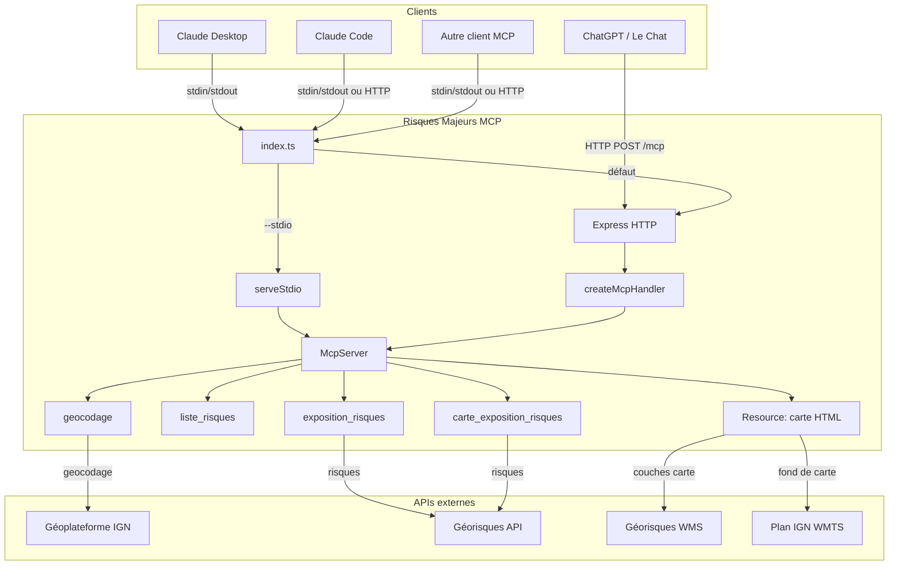
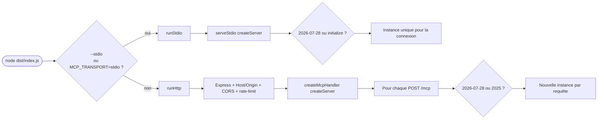
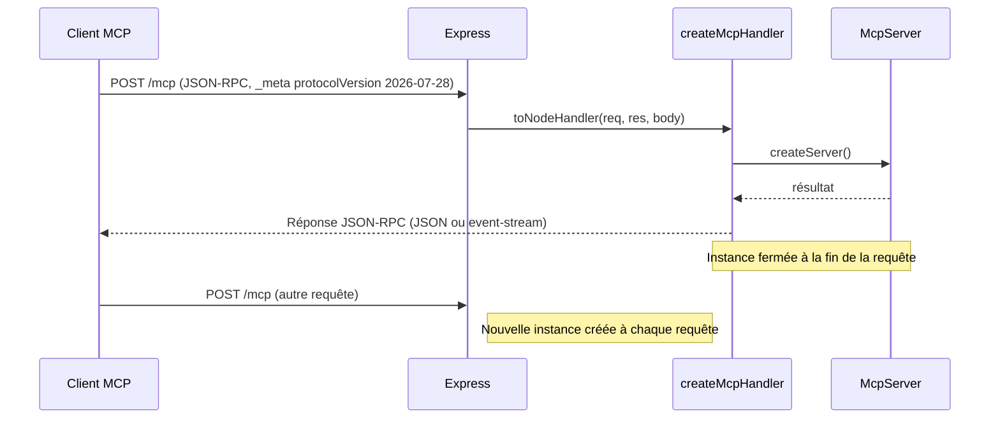
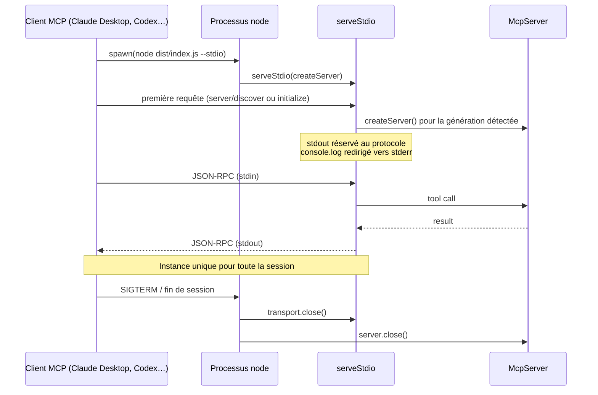

# Architecture

## Vue d'ensemble

Le serveur supporte **deux transports MCP** au choix : **stdio** (le client lance le serveur comme sous-processus) et **Streamable HTTP** (le serveur écoute sur un port). Les deux modes partagent exactement le même `McpServer` et les mêmes outils — seule la couche transport change.

Le serveur est construit avec le [SDK TypeScript MCP v2](https://github.com/modelcontextprotocol/typescript-sdk) (`@modelcontextprotocol/server`) et implémente la révision **2026-07-28** de la spécification MCP, tout en restant compatible avec les clients des révisions 2025 (2025-03-26 à 2025-11-25).



## Structure du projet

```
risques-majeurs-mcp/
├── server/                 # Code serveur (TypeScript, compile par tsc)
│   ├── index.ts            # Point d'entrée : Express + Streamable HTTP, ou stdio
│   ├── server.ts           # Définition du serveur MCP et des outils
│   ├── risques.ts          # Définition des 12 risques (fetch, schéma, texte, couches)
│   └── utils.ts            # Helpers (appels API, dates, sources WMS, icônes SVG)
├── client/                 # Application carte (TypeScript, bundle par Vite)
│   ├── mcp-app.html        # Page HTML
│   ├── mcp-app.ts          # App MCP (MapLibre GL)
│   ├── mcp-app.css         # Styles
│   └── controls.ts         # Controles MapLibre (couches, légendes, plein ecran)
├── dist/                   # Build de production (génère)
├── documentation/          # Documentation Docusaurus
├── package.json
├── tsconfig.json           # Config TypeScript client
├── tsconfig.server.json    # Config TypeScript serveur
├── vitest.config.ts        # Config des tests
└── mise.toml               # Taches mise
```

## Transports MCP

`server/index.ts` détecte le flag CLI `--stdio` (ou la variable `MCP_TRANSPORT=stdio`) au démarrage et choisit le transport en conséquence. Les deux modes partagent le même `McpServer`, créé par `createServer()` dans `server/server.ts`.



### Mode Streamable HTTP (par défaut)

Le serveur écoute sur `http://localhost:3000/mcp`. Les requêtes sont traitées par `createMcpHandler` (SDK v2), branché sur Express via `toNodeHandler` (`@modelcontextprotocol/node`). Chaque requête HTTP crée une nouvelle instance du `McpServer`, sans gestion de sessions. C'est un choix délibéré : tous les outils exposés sont en lecture seule et idempotents, il n'y a donc pas besoin de maintenir un état entre les requêtes.

Le handler sert les deux générations du protocole :

- **Clients 2026-07-28** : le protocole est sans état par conception. Il n'y a ni handshake `initialize` ni en-tête `Mcp-Session-Id` : chaque requête porte dans `params._meta` la version du protocole, les capacités et l'identité du client, et les en-têtes `MCP-Protocol-Version`, `Mcp-Method` (et `Mcp-Name` pour `tools/call` / `resources/read`) permettent le routage. Le client découvre le serveur avec `server/discover`.
- **Clients 2025** (révisions 2025-03-26 à 2025-11-25) : repli *stateless*, avec une instance par requête et sans identifiant de session.

Les requêtes `GET` et `DELETE` sur `/mcp` reçoivent une réponse `405` : il n'y a ni flux SSE autonome ni session à fermer. La liste des outils et la ressource de la carte étant fixes, le serveur annonce `listChanged: false` pour `tools` et `resources` : les clients 2026-07-28 n'ouvrent donc pas de flux `subscriptions/listen`. Un client qui en ouvre un quand même reçoit l'accusé de réception, puis la fin du flux. `createMcpExpressApp` (`@modelcontextprotocol/express`) valide les en-têtes `Host` et `Origin` lorsque le serveur écoute sur `127.0.0.1`, ou selon `ALLOWED_HOSTS` / `ALLOWED_ORIGINS` (une origine invalide reçoit une erreur 403).



Avantages : multi-clients, hot-reload en dev, exposition possible via tunnel HTTPS (ngrok, cloudflared) pour ChatGPT / Le Chat.

### Mode stdio

Le client MCP lance le serveur comme sous-processus et communique via stdin (requêtes) / stdout (réponses). Une seule instance du `McpServer` vit pour toute la durée du processus.



Avantages : pas de port à ouvrir, démarrage simple via `npx -y --allow-git=all github:MAIF/risques-majeurs-mcp --stdio`, isolation par client.

### Comparatif

| Aspect | Streamable HTTP | stdio |
|---|---|---|
| Lancement | `npm start` (ou équivalent) | Le client lance le processus |
| Communication | HTTP POST sur `/mcp` | stdin / stdout |
| Cycle de vie | Nouvelle instance par requête | Instance unique par processus |
| Multi-clients | Oui (un seul serveur partagé) | Non (un processus par client) |
| Logs | `console.log` → stdout | Redirigé vers stderr (stdout = protocole) |
| Cas d'usage | Dev (hot-reload), tunnel public, multi-utilisateurs | Claude Desktop, Codex CLI, install via `npx` |

## Build

Le build se fait en deux etapes :

1. **Serveur** : `tsc` compile les fichiers TypeScript de `server/` vers `dist/` (target ES2024, modules Node16)
2. **Client** : Vite bundle `client/mcp-app.html` en un **fichier HTML unique** (via `vite-plugin-singlefile`) dans `dist/client/`

Le fichier HTML unique est ensuite servi comme ressource MCP (`text/html;profile=mcp-app`) par le serveur, ce qui permet au client MCP d'afficher la carte directement. MapLibre GL v6 chargeant son worker depuis une URL, le code du worker est embarqué dans la page et exposé via une URL `blob:`. La ressource déclare dans sa CSP les seuls domaines contactés : `data.geopf.fr` (fond de carte) et `www.georisques.gouv.fr` (couches WMS et légendes).

## Définition d'un risque

Chaque risque dans `server/risques.ts` est un objet avec la structure suivante :

```typescript
{
  code: string;            // Identifiant unique
  libelle: string;         // Nom affiche
  fetch(lon, lat);         // Appel API Georisques (aiguillage vers l'endpoint v1 ou v2 selon la configuration du jeton d'authentification)
  outputSchema: ZodSchema; // Schéma de sortie (Zod)
  text(exposition);        // Rendu texte
  layers: [{               // Couches carte (peut être vide)
    id: string;
    nom: string;
    source(exposition);    // Source MapLibre (raster WMS ou GeoJSON)
    layer: object | object[];   // Config de la couche MapLibre (tableau accepte pour appliquer différents styles)
    legend(exposition);    // Element DOM de légende
  }]
}
```

Cette structure modulaire facilite l'ajout de nouveaux risques : il suffit d'ajouter un nouvel objet au tableau `RISQUES`.
